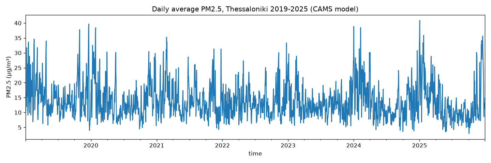
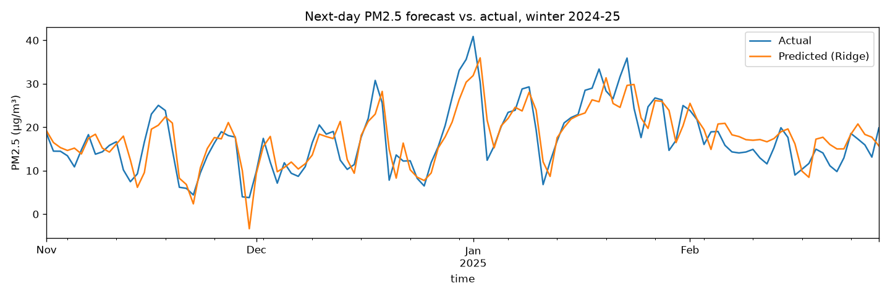

# Forecasting Next-Day PM2.5 in Thessaloniki

Can we predict tomorrow's average fine-particle pollution (PM2.5) in Thessaloniki from today's air quality and the weather? This project builds and evaluates daily forecasting models on 7 years of hourly data (2019-2025).

**Tools:** Python, pandas, NumPy, scikit-learn, Matplotlib, Open-Meteo APIs



## Data

- **Air quality:** hourly PM2.5, PM10, NO2 and ozone from the [Open-Meteo Air Quality API](https://open-meteo.com/en/docs/air-quality-api), based on CAMS European air quality data (Copernicus Atmosphere Monitoring Service, CAMS ENSEMBLE).
- **Weather:** hourly temperature, humidity, wind, pressure and precipitation from the [Open-Meteo Historical Weather API](https://open-meteo.com/en/docs/historical-weather-api) (ERA5 reanalysis).
- 61,368 hourly records with no missing values, aggregated to 2,554 days.

**Important:** the pollution values are **modeled** (CAMS, ~11 km grid), not readings from ground monitoring stations. The model therefore forecasts modeled PM2.5.

To reproduce:

```
pip install -r requirements.txt
python src/download_data.py
```

Then run `notebooks/01_exploration.ipynb`.

## Method

1. Aggregated hourly data to daily means (precipitation summed). Wind direction was converted to east-west and north-south vector components before averaging, since averaging angles directly gives wrong results.
2. Features: today's pollution levels, yesterday's PM2.5, a 3-day rolling mean, weather, and season encoded as sine/cosine of the day of year.
3. **Time-based split:** trained on 2019-2023, tested on 2024-2025, so the model never learns from the future.
4. Compared Ridge regression, Random Forest and Gradient Boosting against two baselines.

## Results

Mean absolute error (MAE) on 2024-2025, in µg/m³:

| Model | Today's weather only | + next-day weather |
|---|---|---|
| Mean baseline | 5.34 | n/a |
| Persistence ("tomorrow = today") | 2.97 | 2.97 |
| Gradient Boosting | 2.90 | n/a |
| Random Forest | 2.81 | 2.40 |
| **Ridge regression** | **2.81** | **2.40 (19% better than persistence)** |



## Key findings

- **Strong winter seasonality:** PM2.5 peaks every winter (up to ~40 µg/m³), consistent with residential heating and cold, stagnant air.
- **Persistence is a hard benchmark:** simply repeating today's value halves the error of predicting the average.
- **Next-day weather drives day-to-day change:** with today's weather only, models beat persistence by ~5%. Adding next-day weather raised the gain to 19%.
- **Physically consistent drivers:** stronger next-day wind lowers predicted PM2.5, warming days raise it and cooling days lower it, and humid conditions are associated with higher PM2.5.
- **Gains are seasonal:** the model clearly beats persistence in winter and spring, when pollution varies most, but not in summer, when levels are low and stable.
- **A simple model is enough:** Ridge regression matched Random Forest, so the linear model was kept for its simplicity and interpretability.

## Limitations

- Pollution data is modeled (CAMS), not measured at stations.
- Next-day weather uses actual reanalysis values as a stand-in for a weather forecast, so the 19% gain is an **upper bound**. Real forecast errors would reduce it.
- Results come from a single 2-year test period. Rolling-origin evaluation across years would give a more robust estimate.
- Feature coefficients are affected by correlated inputs and should be read as directions, not exact effects.

## Repo structure

```
src/download_data.py         downloads and merges hourly data
notebooks/01_exploration.ipynb   analysis, features, models
figures/                     charts used in this README
requirements.txt
```

Data: CAMS ENSEMBLE via Open-Meteo, and ERA5 reanalysis via Open-Meteo.